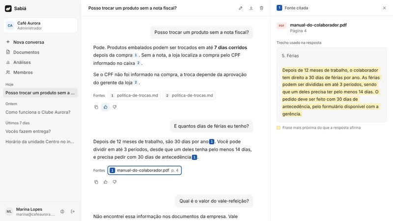
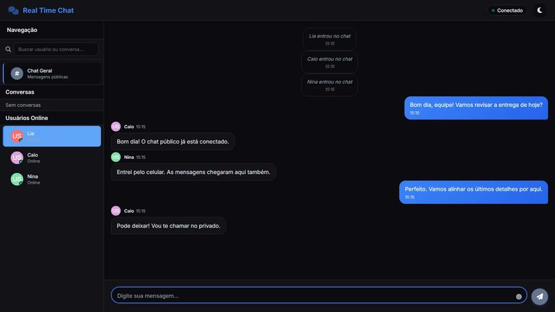
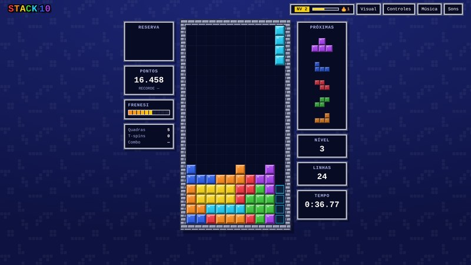
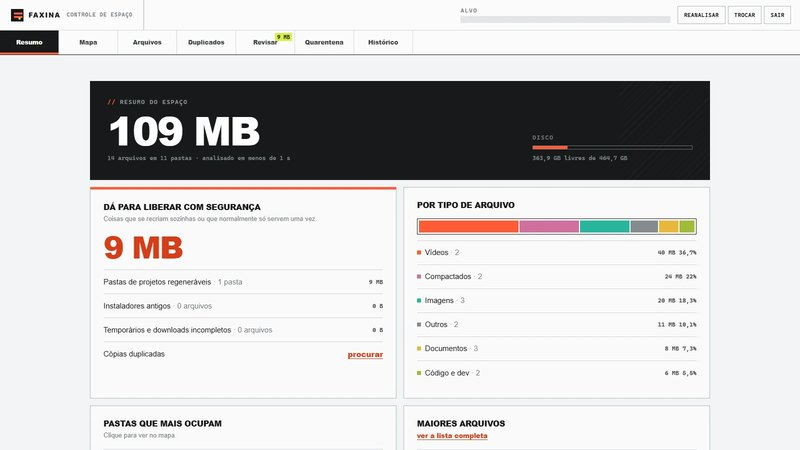

# Pedro Bicas

Desenvolvedor full-stack em São Paulo. Construo sistemas web completos com Java, Spring Boot e Angular, do banco de dados à interface. Trabalho com desenvolvimento desde 2024 e estou no último ano de Engenharia de Software na FIAP.

[Portfólio](https://pedrobicas.com) · [Currículo](https://pedrobicas.com/curriculo) · [LinkedIn](https://www.linkedin.com/in/pedrobicas) · [E-mail](mailto:pedro.bicas14@gmail.com)

## Projetos

<table>
  <tr>
    <td width="50%" valign="top">
      
       <b>Sabiá</b>
       Assistente de base de conhecimento com RAG. Cada resposta cita o documento e o trecho de origem.
       Java · Spring Boot · Spring AI · Angular · PostgreSQL · pgvector
       <a href="https://sabia.pedrobicas.com">Demo</a> · <a href="https://github.com/pedrobicas/sabia">Código</a>
    </td>
    <td width="50%" valign="top">
      
       <b>Chat em tempo real</b>
       Sala pública e conversas privadas, com usuários online e indicador de digitação.
       Java · Spring Boot · WebSocket/STOMP · Angular · RxJS
       <a href="https://github.com/pedrobicas/java-realtime-chat">Back-end</a> · <a href="https://github.com/pedrobicas/web-realtime-chat">Front-end</a>
    </td>
  </tr>
</table>

<table>
  <tr>
    <td width="50%" valign="top">
      
       <b>STACK10</b>
       Puzzle de blocos com simulação determinística a 120&nbsp;Hz e replay de partidas.
       JavaScript · Canvas 2D · Web Audio API · Vite
       <a href="https://stack10.pedrobicas.com">Demo</a> · <a href="https://github.com/pedrobicas/STACK10">Código</a>
    </td>
    <td width="50%" valign="top">
      
       <b>Faxina</b>
       Mostra o que ocupa espaço no disco e faz a limpeza com quarentena reversível.
       Python · HTML · CSS · JavaScript · SQLite
       <a href="https://github.com/pedrobicas/faxina">Código</a>
    </td>
  </tr>
</table>

Outros projetos e as decisões técnicas de cada um estão em [pedrobicas.com](https://pedrobicas.com).

## Stack

- **Back-end:** Java, Spring Boot, Spring Security, Spring AI, APIs REST, WebSocket, Node.js, Python
- **Front-end:** Angular, TypeScript, RxJS, React, Next.js, JavaScript, Sass, Tailwind CSS
- **Dados:** PostgreSQL, pgvector, MySQL, SQLite
- **Testes e infra:** JUnit, Playwright, Docker, GitHub Actions, Git, Linux

## Trajetória

**Desenvolvedor full-stack (bolsista de P&D)** · InCor (HC-FMUSP) · 2024 – hoje 
Principal desenvolvedor de dois sistemas em produção, da arquitetura aos contêineres Docker: uma plataforma web (Angular, Spring Boot, PostgreSQL) e uma API que executa algoritmos em Python e entrega os resultados a outras aplicações.

**Engenharia de Software** · FIAP · 2023 – 2026 
Bolsa Mérito e 3º lugar no desafio Next 2024.

**Técnico em Análise e Desenvolvimento de Sistemas** · SENAI · 2021 – 2022

<b>English</b>

 

Full-stack developer based in São Paulo, Brazil, working mainly with Java, Spring Boot and Angular. Since 2024 I've been the main developer of two production systems at InCor (HC-FMUSP): a web platform and an API that runs Python algorithms. I'm in the final year of a Software Engineering degree at FIAP.

The projects above are Sabiá (a RAG knowledge-base assistant that cites its sources), a real-time chat with Spring Boot and Angular, STACK10 (a deterministic browser puzzle with replays) and Faxina (a local disk cleanup tool). More at [pedrobicas.com](https://pedrobicas.com).

