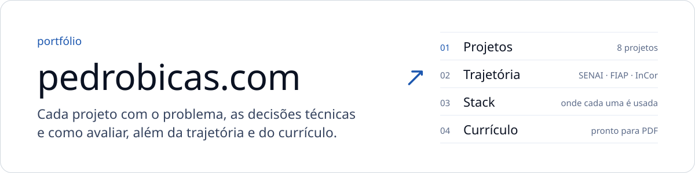

<a href="https://pedrobicas.com">
  <picture>
    <source media="(max-width: 768px) and (prefers-color-scheme: dark)" srcset="./assets/header-celular-dark.svg">
    <source media="(max-width: 768px)" srcset="./assets/header-celular-light.svg">
    <source media="(prefers-color-scheme: dark)" srcset="./assets/header-dark.svg">
    
  </picture>
</a>

 

Desenvolvedor de software com foco em aplicações web **full-stack**, principalmente com **Angular, TypeScript, Java e Spring Boot**.

Atuo profissionalmente com desenvolvimento de software desde 2024 e estou concluindo Engenharia de Software na FIAP. Nos projetos pessoais, gosto de explorar arquitetura de software, comunicação em tempo real, ferramentas úteis e experiências interativas, da interface à implementação.

[**Portfólio**](https://pedrobicas.com) · [Currículo](https://pedrobicas.com/curriculo) · [LinkedIn](https://www.linkedin.com/in/pedrobicas) · [E-mail](mailto:pedro.bicas14@gmail.com)

## Portfólio

<a href="https://pedrobicas.com">
  <picture>
    <source media="(max-width: 768px) and (prefers-color-scheme: dark)" srcset="./assets/portfolio-celular-dark.svg">
    <source media="(max-width: 768px)" srcset="./assets/portfolio-celular-light.svg">
    <source media="(prefers-color-scheme: dark)" srcset="./assets/portfolio-dark.svg">
    
  </picture>
</a>

### Projetos selecionados

- **[Sabiá](https://github.com/pedrobicas/sabia)** · Assistente de base de conhecimento para empresas com **RAG**, em **Spring Boot, Spring AI, Angular e pgvector**. Cada resposta cita o documento e o trecho de onde saiu, e a busca combina vetores com palavras-chave. [Demo](https://sabia.pedrobicas.com).
- **[Realtime Chat](https://github.com/pedrobicas/java-realtime-chat)** · Chat em tempo real com **Spring Boot, WebSocket/STOMP e [Angular](https://github.com/pedrobicas/web-realtime-chat)**.
- **[STACK10](https://github.com/pedrobicas/STACK10)** · Puzzle de blocos para navegador, com simulação determinística a **120 Hz** e reprodução de partidas por seed e entradas registradas. [Demo](https://stack10.pedrobicas.com).
- **[Faxina](https://github.com/pedrobicas/faxina)** · Ferramenta local para analisar o espaço em disco, localizar arquivos grandes e duplicados e revisar a limpeza com uma **quarentena reversível**. Os arquivos são processados no próprio computador.

## Stack

| Área | Tecnologias |
| :--- | :--- |
| **Front-end** | **Angular · TypeScript** · RxJS · React · Next.js · Sass · Tailwind CSS |
| **Back-end** | **Java · Spring Boot** (Web, Security, Data JPA) · Spring AI · APIs REST · WebSocket · Node.js · Python |
| **Dados** | PostgreSQL · pgvector · MySQL · SQLite |
| **Testes e infraestrutura** | JUnit · Mockito · Playwright · Docker · GitHub Actions · Git · Linux |

## Experiência e formação

- **InCor (HC-FMUSP)** · Desenvolvedor full-stack (bolsista de P&D), desde 2024. Desenvolvi praticamente sozinho dois sistemas em produção, com usuários reais: uma plataforma web (Angular, Spring Boot, PostgreSQL) e uma API que executa algoritmos em Python, da arquitetura aos contêineres Docker.
- **FIAP** · Engenharia de Software (2023–2026). Bolsa Mérito e 3º lugar no desafio Next 2024.
- **SENAI** · Técnico em Desenvolvimento de Sistemas (2021–2022).

<b>English</b>

 

I'm a full-stack software developer based in São Paulo, Brazil, primarily working with **Angular, TypeScript, Java, and Spring Boot**.

I've worked in software development since 2024 as a full-stack developer (R&D fellowship) at InCor (HC-FMUSP), where I built, almost single-handedly, two systems now in production: a web platform (Angular, Spring Boot, PostgreSQL) and an API that runs Python algorithms. I'm completing a Software Engineering degree at FIAP and have a technical diploma in Software Development from SENAI.

My selected projects include **[Sabiá](https://github.com/pedrobicas/sabia)** (a RAG knowledge-base assistant built with Spring Boot, Spring AI, Angular, and pgvector, where every answer cites its source; [demo](https://sabia.pedrobicas.com)), **[Realtime Chat](https://github.com/pedrobicas/java-realtime-chat)** (an Angular and Spring Boot real-time messaging application), **[STACK10](https://github.com/pedrobicas/STACK10)** (a deterministic browser puzzle with replay support), and **[Faxina](https://github.com/pedrobicas/faxina)** (a local disk analysis and reversible cleanup tool).

[**Portfolio**](https://pedrobicas.com) · [Résumé](https://pedrobicas.com/curriculo) · [LinkedIn](https://www.linkedin.com/in/pedrobicas) · [Email](mailto:pedro.bicas14@gmail.com)

