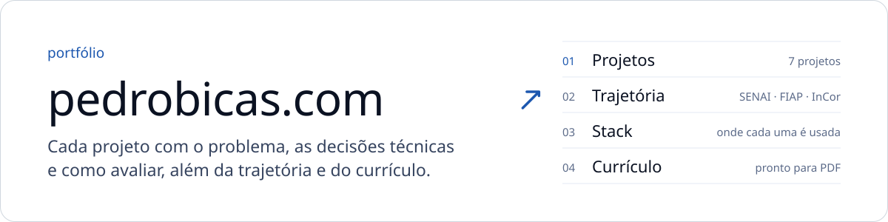

<a href="https://pedrobicas.com">
  <picture>
    <source media="(max-width: 768px) and (prefers-color-scheme: dark)" srcset="./assets/header-celular-dark.svg">
    <source media="(max-width: 768px)" srcset="./assets/header-celular-light.svg">
    <source media="(prefers-color-scheme: dark)" srcset="./assets/header-dark.svg">
    
  </picture>
</a>
  

Construo aplicações web completas, da interface ao banco de dados, principalmente com **Java e Spring Boot** no back-end e **Angular** ou **React** no front-end. Trato testes, CI e documentação como parte da entrega, não como extra.

**[pedrobicas.com](https://pedrobicas.com)** · [Currículo](https://pedrobicas.com/#/curriculo) · [LinkedIn](https://www.linkedin.com/in/pedro-bicas) · [pedro.bicas14@gmail.com](mailto:pedro.bicas14@gmail.com)

## Hoje

- **InCor (HC-FMUSP)** · bolsista em desenvolvimento desde 2024. APIs REST para integrar sistemas internos e dashboards de dados clínicos para pesquisa, com Python, Django, React e PostgreSQL.
- **FIAP** · Engenharia de Software (2023–2026), com Bolsa Mérito e 3º lugar no desafio Next 2024.
- **SENAI** · Técnico em Análise e Desenvolvimento de Sistemas (2021–2022).

## Portfólio

<a href="https://pedrobicas.com">
  <picture>
    <source media="(max-width: 768px) and (prefers-color-scheme: dark)" srcset="./assets/portfolio-celular-dark.svg">
    <source media="(max-width: 768px)" srcset="./assets/portfolio-celular-light.svg">
    <source media="(prefers-color-scheme: dark)" srcset="./assets/portfolio-dark.svg">
    
  </picture>
</a>

**Alguns projetos**

- **[BetAware](https://github.com/pedrobicas/BetAwareAPI)** · em equipe: plataforma sobre os riscos das apostas, com API em Spring Boot e JWT, [web](https://github.com/pedrobicas/BetAwareWeb) em Angular e [app](https://github.com/pedrobicas/BetAwareApp) em React Native.
- **[Chat em tempo real](https://github.com/pedrobicas/java-realtime-chat)**: sala pública e conversas privadas com Spring Boot, WebSocket/STOMP e [Angular](https://github.com/pedrobicas/web-realtime-chat).
- **[My Universe](https://github.com/pedrobicas/my-universe-spotify)**: painel da conta Spotify com login OAuth2, em React e Node.js · [demo](https://my-universe-spotify.vercel.app)
- **[STACK10](https://github.com/pedrobicas/STACK10)**: puzzle no navegador com simulação determinística a 120 Hz e replays por seed · [demo](https://stack10.pedrobicas.com)

## Stack

| Área              | Tecnologias                                                                            |
| :---------------- | :------------------------------------------------------------------------------------- |
| Back-end          | Java · Spring Boot (Web, Security, Data JPA) · Node.js · Express · Python · FastAPI · Django |
| Front-end         | Angular · React · Next.js · TypeScript · RxJS · Sass · Tailwind CSS                    |
| Mobile            | React Native (Expo)                                                                    |
| Dados             | PostgreSQL · MySQL · SQLite · Pandas                                                   |
| Qualidade e infra | JUnit · Mockito · pytest · Playwright · Docker · GitHub Actions · Linux                |

<b>English</b>

 

Full-stack developer based in São Paulo, Brazil. I build complete web applications, from the interface to the database, mostly with Java and Spring Boot on the back end and Angular or React on the front end.

I currently work as a software developer (fellowship) at InCor, the Heart Institute of Hospital das Clínicas, University of São Paulo Medical School, building REST APIs and clinical data dashboards for research. I study Software Engineering at FIAP.

My portfolio at [pedrobicas.com](https://pedrobicas.com) covers each project with the problem, the technical decisions and how to evaluate it. Highlights include **BetAware** (team project: Spring Boot API with JWT, Angular web app and React Native app), a **real-time chat** (Spring Boot, WebSocket/STOMP and Angular), **My Universe** (Spotify dashboard with OAuth2) and **STACK10** (browser puzzle with a deterministic 120 Hz simulation).

[LinkedIn](https://www.linkedin.com/in/pedro-bicas) · [pedro.bicas14@gmail.com](mailto:pedro.bicas14@gmail.com)

